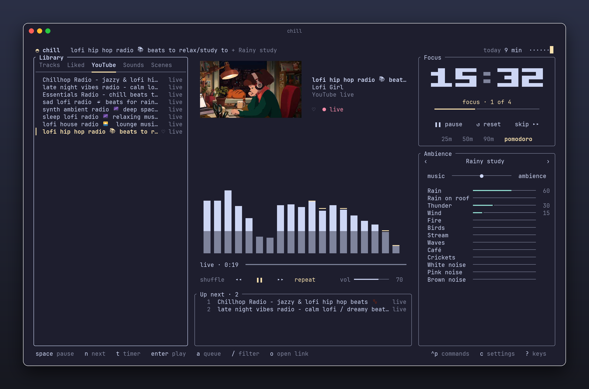
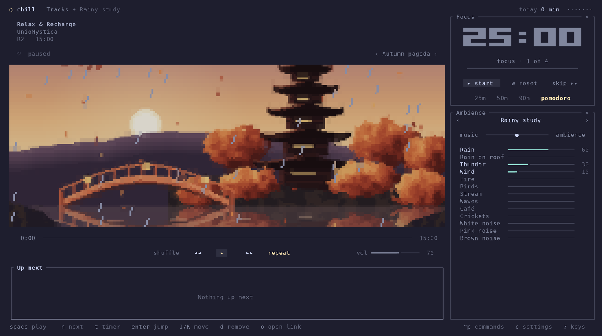

# chill

A terminal player for focused work. It plays lo-fi from a hosted catalog or from YouTube, layers ambient sound underneath, and runs a focus timer that keeps track of the time you actually spent focusing. It ships as one binary for macOS and Windows.



## Install

chill drives three tools it doesn't ship:

| Tool | What chill uses it for | macOS | Windows |
| --- | --- | --- | --- |
| ffmpeg | decoding every stream | `brew install ffmpeg` | `winget install Gyan.FFmpeg` |
| yt-dlp and deno | resolving YouTube links | `brew install yt-dlp deno` | `winget install yt-dlp.yt-dlp DenoLand.Deno` |

Then install chill itself. Prebuilt binaries cover Apple Silicon Macs and 64-bit Windows.

```bash
# macOS
curl --proto '=https' --tlsv1.2 -LsSf https://github.com/Aquitano/chill-flow/releases/latest/download/chill-installer.sh | sh
```

```powershell
# Windows
powershell -ExecutionPolicy Bypass -c "irm https://github.com/Aquitano/chill-flow/releases/latest/download/chill-installer.ps1 | iex"
```

Both put `chill` in `~/.cargo/bin` and add it to `PATH`. Run the same command again to update. On any other platform, build it with the Rust toolchain from [rustup.rs](https://rustup.rs) (on Windows that also needs the Visual Studio C++ build tools):

```bash
cargo install --git https://github.com/Aquitano/chill-flow
```

After a winget install, open a new terminal so the tools are on `PATH`. `chill doctor` checks that all three are found and prints where chill keeps its config, library, and cache. YouTube changes often enough that an old yt-dlp stops working, so chill mentions it at startup once your yt-dlp is more than 60 days old; update it with `brew upgrade yt-dlp` or `winget upgrade yt-dlp.yt-dlp`.

## Use

`chill` opens with your last scene loaded and paused. Space starts the music and the ambience, and `t` starts the focus timer. Each runs without the other, so you can just listen, and `F` puts the timer away until you need it. `H` and `L` put away the library on the left and the ambience and timer on the right, so the player fills the window.

```bash
chill                                   # resume where you left off
chill https://youtu.be/…                # play a video, playlist, or live stream
chill "rainy study"                     # load a saved scene
chill doctor                            # check ffmpeg, yt-dlp, and deno
```

Paste a YouTube link anywhere in the app to add it to the library and play it. Everything responds to the mouse: click rows and buttons, drag the sliders, scroll the lists. Press `?` for every key, or `ctrl+p` to search all commands.

| Key | Does |
| --- | --- |
| `space` | play or pause the music and ambience |
| `n` / `p` | next / previous |
| `f` | like what's playing |
| `<` / `>` | turn the music or the ambience up against the other |
| `t` / `T` | start or pause the timer / reset it |
| `F` | hide the timer until you use it again |
| `H` / `L` | hide or show the left / right side |
| `v` | next picture in the player |
| `o` | open a YouTube link |
| `c` | settings |
| `tab` | move between library, queue, and ambience |
| `enter` / `a` | play the selection / add it to the queue |

The library has five tabs. Tracks come from the catalog. Liked holds what you liked. YouTube holds every link you opened. Sounds holds the ambience mixes, which play on their own without music. Scenes holds saved setups of source, ambience, balance, and timer.

To update a saved playlist, select it in YouTube and press `R`, click **R refresh**, or search for **Refresh playlist** in the command palette.

The slider between music and ambience at the top of the Ambience panel turns one down against the other, for a loud stream or quiet rain, without touching the volume. A soundscape has no music, so the balance leaves it alone. White, pink, and brown noise sit below the recordings; chill generates them, so they need no download and play offline.

The player shows the cover of what's playing, or `v` swaps it for a moving picture drawn in text: Night lake, Fuji at dawn, or Autumn pagoda. A picture moves while something plays and shows the ambience you hear: rain falls while a rain sound plays, thunder lights up the sky, wind sways trees and water, and crickets bring out fireflies, each as strongly as the music and ambience balance lets you hear it. Night lake uses your terminal's colors; the other two bring their own. **Settings** chooses the picture and what draws it. Auto, the default, draws Night lake in braille dots. Fuji at dawn and Autumn pagoda get blocks once the player has room for each of their pixels, as when both sides are put away, and crisp pixels before that. Blocks show each pixel as a solid cell with a thin seam beside it and work in any font. Pixels keep a painting crisp at eight to a cell, and Smooth paints it finer and scales it smoothly. Both, and the solid shapes among the dots such as Night lake's boat, use octant characters from Unicode 16; Ghostty draws them itself, and other terminals need a font that has them.



Focus stats count every minute a focus block ran, including blocks you stopped early. Breaks never count. The header shows today's total and a seven-day sparkline; press `i` for the chart.

## Catalog

`catalog.json` lists the R2 tracks, the ambient sounds, and the built-in mixes. chill reads it from `catalog_url`, keeps the last copy it fetched for offline starts, and falls back to the copy compiled into the binary from this repository. File names resolve against the folder the catalog sits in.

Someone can share another catalog with you as a link to its `catalog.json`. Search for **Add a catalog** in the command palette and paste the link; its tracks join Tracks, each showing which catalog it came from, and **Remove catalog** takes it out again. When two catalogs use the same id, the main catalog's entry wins.

`chill-catalog` in `tools/catalog` edits that file and uploads to the bucket. It needs ffmpeg and these variables, from the environment or a `.env` file in the repository:

| Variable | Holds |
| --- | --- |
| `R2_ACCOUNT_ID` | the Cloudflare account id |
| `R2_ACCESS_KEY_ID`, `R2_SECRET_ACCESS_KEY` | an R2 API token with write access to the bucket |
| `R2_BUCKET` | the bucket name |
| `R2_JURISDICTION` | the bucket's jurisdiction, such as `eu`; leave it unset for the default |

```bash
cargo run -p chill-catalog -- add-track night-drive.wav --title "Night Drive" --artist "…" --cover cover.png --tag focus
cargo run -p chill-catalog -- add-sound rain.flac --label "Rain" --credit "…, CC0 1.0" --start 2 --length 75 --gain 90
cargo run -p chill-catalog -- check
cargo run -p chill-catalog -- publish
```

`add-track` normalizes the audio to -14 LUFS and `add-sound` cuts a loop and normalizes it to -16 LUFS, both as 192 kbps MP3. They upload the file (and cover), then add the entry to `catalog.json`; the id defaults to the title or label in lowercase with dashes. `check` validates the catalog and confirms the public bucket serves every file it names. `publish` runs `check` and uploads `catalog.json`, which clients cache for five minutes. Add `--dry-run` to any command to see what would be uploaded and written without touching the bucket or the file. Commit `catalog.json` after publishing, so the copy compiled into the next release matches.

Audio and covers are served as immutable and cached for a year, so a client that fetched a file never asks for it again. A changed recording needs a new name: pass a new `--id`. The tool refuses to replace an existing file unless you pass `--force`.

To share music outside the main catalog, start a catalog of its own. `new` creates the file with a `url` under a random folder of the bucket, and `--catalog` points every other command at it:

```bash
cargo run -p chill-catalog -- new ~/chill/friends.json --name "Friends"
cargo run -p chill-catalog -- --catalog ~/chill/friends.json add-track home.wav --title "Home" --artist "…"
cargo run -p chill-catalog -- --catalog ~/chill/friends.json publish
```

The folder is hard to guess, not secret: anyone with the link can play the files, and taking access back means publishing under a new folder. Only put music there that you may share. Keep the file outside this repository, since it holds the link, and `check` flags ids that the main catalog already uses.

## Sync

Sync carries your library, likes, scenes, mixes, focus history, and settings between machines. It is off until you search for **Turn on sync** in the command palette, which creates a sync space on the server. To add another machine, run **Copy sync key** on the first and paste the key into **Join a sync space** on the second. The key is the only thing that opens the space, so keep it like a password.

chill syncs when it starts, every hour while it runs, and when it quits, or right away with **Sync now**. Everything still lives in `chill.db` on each machine, so chill works offline and catches up on the next sync. When the same item changed on two machines, the later change wins. **Turn off sync** stops syncing and keeps everything on the machine. **Delete sync data** removes everything the space holds from the server and closes it, so every machine stops syncing and keeps its own library.

The server is the Worker in [`sync/`](sync/README.md). It stores what syncs as it is, readable by whoever runs it, but nothing that names you: no account, email, or IP address. The key only travels over https.

## Configuration

Press `c` for settings: timer lengths, auto-start, the chime, notifications, the picture, and reduced motion. Changes save to `config.toml` right away, keeping anything else you wrote in it. The file is optional and lives in `~/.config/chill/` on macOS and `%APPDATA%\chill\` on Windows. These are the defaults:

```toml
catalog_url = "https://chill-data.aquitano.me/catalog.json"
catalogs = []           # more catalog.json links, added with "Add a catalog"
sync_url = "https://chill-sync.aquitano.me"
reduce_motion = false   # true turns off transitions and the visualizer, and holds pictures still
picture = "cover"       # or "night-lake", "fuji-dawn", "autumn-pagoda"
look = "auto"           # how pictures are drawn: "auto", "blocks", "pixels", "smooth", or "dots"
chime = true            # a soft bell when a focus block or break ends
notifications = true    # an OS notification at the same moments

[pomodoro]
focus_minutes = 25
break_minutes = 5
long_break_minutes = 15
long_break_every = 4
auto_start_breaks = true
auto_start_focus = true
```

The library, likes, scenes, mixes, focus history, and the resume point live in `chill.db`. That file sits in `~/.local/share/chill/` on macOS and `%APPDATA%\chill\` on Windows. Cached ambient loops and the catalog go to `~/.cache/chill/` or `%LOCALAPPDATA%\chill\`.

## Development

```bash
cargo run
cargo test --workspace
cargo clippy --all-targets --workspace -- -D warnings
```

On Linux the build needs `libasound2-dev`. CI runs the checks on Linux, macOS, and Windows. Pushing a version tag such as `v0.1.0` builds the binaries and installers and publishes them as a GitHub release; bump `version` in `Cargo.toml` to match first.

## Ambient recordings

| Sound | Source | License |
| --- | --- | --- |
| Rain, Rain on roof, Thunder, Fire | USC Cinema / Sunset Editorial Collection | CC0 1.0 |
| Wind | Tvabutzku1234 | CC0 1.0 |
| Birds | ezwa | Public domain |
| Stream | Juandev | Public domain |
| Waves | Dsw4 | Public domain |
| Café | Stephan (pdsounds.org) | Public domain |
| Crickets | Serg Childed | CC BY-SA 4.0 (the trimmed loop is an adaptation and stays BY-SA) |

## License

The code is licensed under the [Apache License 2.0](LICENSE). The Fuji at dawn and Autumn pagoda pictures are ported from [ascii-magic-art](https://github.com/kailashsr38/ascii-magic-art) and keep its [MIT license](licenses/ascii-magic-art.txt). The audio in the catalog is not part of this repository and keeps the licenses listed above.
